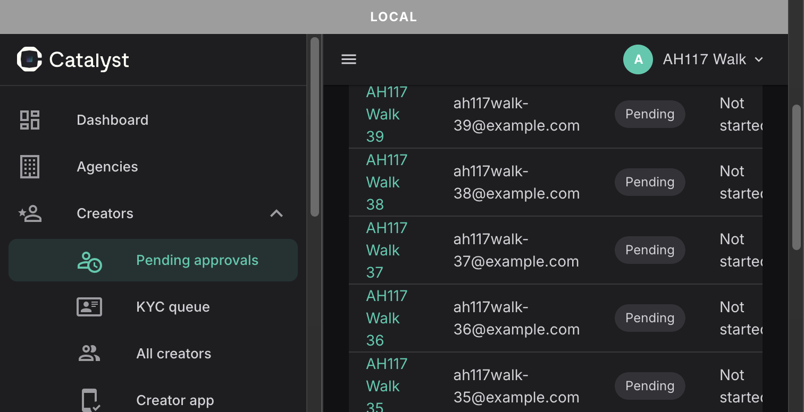
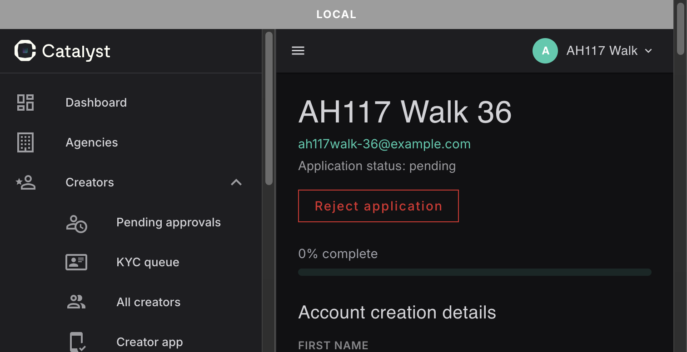
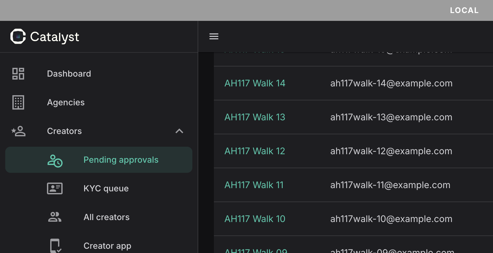

# AH-117 — admin list navigation: review

**Status:** built, committed, **pushed to `origin/main`**, **not deployed.** Pushing is not deploying. The admin SPA in production is, as reported by Pedram, at the 2026-10-29 build; it stays there until the colleague deploys the admin Netlify site from the mirror (see the `PENDING` entry in [`deploy-log.md`](../runbooks/deploy-log.md)).

**Mode:** A, full loop (inventory, plan, build in steps S0 to S7, review, docs). **Plan:** [`admin-list-navigation-plan.md`](admin-list-navigation-plan.md). **Date:** 2026-11-04.

**PROD-DATA RISK: NONE.** `apps/admin` source and tests only. The change reads the same list endpoints with the same parameters (`page`, `per_page`, the filters, `q`); no API change, no migration, no flag, no env, no queue, no write path. See §9 for what the local browser walk did to the **dev** database (seeded, then removed).

Contents: 1 What shipped · 2 Commits · 3 Gates · 4 The S0 probe · 5 Deviations from the plan · 6 Break-reverts · 7 Checkpoint A · 8 Evidence, and where it stops · 9 Process notes and disclosures · 10 Follow-ups · 11 CI · 12 Deploy.

---

## 1. What shipped

Every admin list that this chunk converts keeps its state in the URL query, and the browser's back button returns to it. The detail pages are unchanged: they return by browser back, and there is no new button (ruling Q3).

| Step | What                                                                                                                                                                                                                                                                                                                                                                                                                                                                                                                                                                                                                   |
| ---- | ---------------------------------------------------------------------------------------------------------------------------------------------------------------------------------------------------------------------------------------------------------------------------------------------------------------------------------------------------------------------------------------------------------------------------------------------------------------------------------------------------------------------------------------------------------------------------------------------------------------------- |
| S1   | `useListQueryState(schema)` (new, `apps/admin/src/composables/`): one `Ref` per query param, seeded from the URL; writes with `router.replace` (never `push`, so paging adds no history); codecs `pageParam`, `perPageParam(allowed, fallback)`, `textParam`, `oneOfParamWithFallback`, and `exceedsLastPage`; a two-way re-seed when `route.query` changes (compared by serialized value); the page-1 reset is derived from what changed; a route-driven re-seed scrolls to the top; bound to the route path it was set up on. A trimmed mirror of the one in `apps/main`, header says where it diverges (ruling Q2). |
| S2   | `scrollBehavior` in the admin router: a saved position waits for the page to be tall enough (poll 50 ms, give up at 1200 ms) and is restored; a query-only change on the same path returns `false` (no scroll); anything else goes to the top.                                                                                                                                                                                                                                                                                                                                                                         |
| S3   | Approvals (`CreatorListPage.vue`): page, per page, status.                                                                                                                                                                                                                                                                                                                                                                                                                                                                                                                                                             |
| S4   | KYC queue (`KycQueuePage.vue`): page, per page, KYC status.                                                                                                                                                                                                                                                                                                                                                                                                                                                                                                                                                            |
| S5   | All creators (`AllCreatorsPage.vue`): page, per page, three chips.                                                                                                                                                                                                                                                                                                                                                                                                                                                                                                                                                     |
| S6   | Agencies (`AgencyListPage.vue`): page, per page, status, applied search `q`.                                                                                                                                                                                                                                                                                                                                                                                                                                                                                                                                           |
| S7   | Creator app (`CreatorAppPage.vue`): page, per page, chips, applied search `q`.                                                                                                                                                                                                                                                                                                                                                                                                                                                                                                                                         |

The page pattern for S3 to S7 is the same on every page: one `watch([page, perPage, filters…], load)` plus `onMounted(load)`; `onTableUpdate` only sets `page` and `perPage`; a `requestSeq` guard drops stale responses; the Q10 clamp (set `totalItems` first, then `if (exceedsLastPage(...)) { page.value = last_page; return }`) refetches once; `:items-per-page-options="[10, 25, 50, 100]"` (Vuetify's "All" is gone, default 25). Search on Agencies and Creator app uses a draft `searchInput` (300 ms debounce) that writes the applied `q`; the applied value, trimmed, is the load trigger.

**Not built here (follow-ups, §10):** the cursor and Apply-button lists (Audit log, Impersonation log, Push deliveries), the Erasure queue tab, an admin list E2E.

## 2. Commits

| Step | Commit           | Files (spec count)                                                                                             |
| ---- | ---------------- | -------------------------------------------------------------------------------------------------------------- |
| Plan | `9872a5a4`       | `docs/reviews/admin-list-navigation-plan.md` (pushed earlier, with the plan clearance)                         |
| S1   | `06e8f7b7`       | `useListQueryState.ts`, `.spec.ts` (34 specs), `tests/unit/setup.ts` (a `window.scrollTo = vi.fn()` stub)      |
| S2   | `a9350513`       | `core/router/index.ts`, `tests/unit/core/router/index.spec.ts` (11 new `scrollBehavior` cases, 23 in the file) |
| S3   | `95148533`       | `CreatorListPage.vue` and spec (15)                                                                            |
| S4   | `7de315f4`       | `KycQueuePage.vue` and spec (12)                                                                               |
| S5   | `5cb37a81`       | `AllCreatorsPage.vue` and spec (16)                                                                            |
| S6   | `5d445ba7`       | `AgencyListPage.vue` and spec (14)                                                                             |
| S7   | `7a4e7bab`       | `CreatorAppPage.vue` and spec (36)                                                                             |
| D1   | this docs commit | review, ad-hoc log, tech-debt, deploy-log, resumption template, four screenshots                               |

`git diff ad9f2f79..7a4e7bab -- apps/admin`: 15 files changed, +2714 −117.

## 3. Gates

| Gate                                         | Result                                                                    |
| -------------------------------------------- | ------------------------------------------------------------------------- |
| Admin Vitest, full (after `pkill -f vitest`) | 65 files, **690 of 690** passed                                           |
| `vue-tsc` (admin)                            | clean                                                                     |
| ESLint                                       | clean                                                                     |
| Prettier (`format:check`)                    | clean                                                                     |
| Forbidden-path diff                          | empty: only `apps/admin/src`, `apps/admin/tests` and the plan doc changed |
| Admin Playwright                             | `admin-sign-in` and `admin-mandatory-mfa-enrollment`, **2 of 2** passed   |

Each step was gated on its own before it was committed (`apps/admin/playwright-report/gates.sh`, gitignored). Playwright was run for the series; on this machine it needs `PLAYWRIGHT_BROWSERS_PATH=$HOME/Library/Caches/ms-playwright` and a hand-started admin Vite pointed at the e2e API (§9).

## 4. The S0 probe

Question (plan P1): does `v-data-table-server` keep a controlled `page` of 3 through its first mount, or does it clamp it to 1 (or echo a different page) before the first response arrives? If it did, the fallback would be to render the table only after the first response.

**Result: it keeps it.** A controlled `page=3` survives the mount; the table does not clamp it and does not echo a different page. **The P1 fallback is not needed.** The explicit Q10 clamp (page past `meta.last_page`) is still required, because nothing else corrects a deep link beyond the last page.

**A finding from S3, recorded because it is not obvious:** if the page is moved while `items-length` is 0, the table clamps the page to 1 by itself. The clamp therefore sets `totalItems` **before** it moves the page; with the order reversed the first Approvals clamp spec made three requests instead of two. This is pinned by the "total set before the page move" mutation (§6, S3).

## 5. Deviations from the plan (accepted 2026-11-04)

1. **No explicit echo guard.** The plan (extras to Q2) asked for an echo guard on the four pages. It was built, then dropped: the watcher over `[page, perPage, …]` already ignores a write of the same value, so the guard is unobservable (the mutation that removes it fails nothing). The plan carries a build note; the one-fetch-on-mount property is pinned by the specs instead.
2. **`totalItems` is set before the clamp moves the page** (the §4 finding). The plan's order was the other way round.
3. **An empty-field clear no longer requests.** Agencies and Creator app: clearing an already-empty search field does not issue a request.
4. **Creator app search is trimmed in the request.** The request carries `q.trim()`.

## 6. Break-reverts

Runner: `apps/admin/playwright-report/br.py <label> <mutations.json>` (gitignored; logs in `playwright-report/ah117-br-*.log`). It applies one string mutation at a time with Python (no `sed`), runs the named specs, restores the file, and labels each mutation **caught** (a spec fails and it is the expected one), **caught by another spec** or **not caught**; it ends with a re-green run. A mutation that does not fail anything is treated as a finding about the test, not a pass.

| Step      | Mutations | Final result                                                        |
| --------- | --------- | ------------------------------------------------------------------- |
| S1        | 17        | 17 caught (two passes, see S1 note)                                 |
| S2        | 8         | 8 caught                                                            |
| S3        | 16 listed | 14 caught; 2 not counted (one equivalent, one duplicate, note S3-a) |
| S4        | 16        | 16 caught (one needed a spec split, note S4-a)                      |
| S5        | 22        | 22 caught                                                           |
| S6        | 24        | 23 caught; 1 equivalent, code removed (note S6-a)                   |
| S7        | 32        | 31 caught; 1 caught by another spec, covered by S1 (note S7-a)      |
| **Total** | **135**   | **131 caught; 1 caught by another spec; 3 equivalent or duplicate** |

The tables below show the final state of each step. "First failing spec" is the first failing test of the run that caught it; the full list is in the logs.

### S1 — `useListQueryState`

| Mutation                                       | Result | First failing spec                                                                            |
| ---------------------------------------------- | ------ | --------------------------------------------------------------------------------------------- |
| replace -> push                                | caught | REPLACES rather than pushes, so paging leaves no history to unwind                            |
| drop foreign-key spread                        | caught | carries through query params it does not own                                                  |
| re-seed compares parsed values, not serialized | caught | does not eat a trailing space typed into a text ref (the URL holds the trimmed text)          |
| remove the route.query re-seed                 | caught | RE-SEEDS every ref to its default when the route goes to the bare URL (a sidebar click)       |
| reset rule ignores whether page changed        | caught | writes changed params back to the URL                                                         |
| reset rule removed                             | caught | sends the page back to 1 when a chip changes from page 3, in the same write                   |
| reset also on per_page                         | caught | does not reset the page when only the page size changes                                       |
| perPageParam drops the allow-list              | caught | accepts only the page sizes the table offers (10, 25, 50, 100), and reads anything else as 25 |
| pageParam accepts 0                            | caught | rejects a zero, negative, fractional or non-numeric page                                      |
| pageParam serializes page 1                    | caught | omits a param sitting at its default, keeping an untouched list on a clean URL                |
| drop the re-seed scroll                        | caught | scrolls to the top once when a route-driven re-seed moves a ref                               |
| scroll on a user edit                          | caught | does not loop: one user change is one replace, and the re-seed that follows sets nothing      |
| re-seed ignores the route it is bound to       | caught | neither re-seeds nor writes once the route has left the list (a row opened a detail page)     |
| write ignores the route it is bound to         | caught | neither re-seeds nor writes once the route has left the list (a row opened a detail page)     |
| synced not updated after a write               | caught | sends the page back to 1 when a chip changes from page 3, in the same write                   |
| re-seed does not refresh synced                | caught | RE-SEEDS from one linked state to another and keeps the page, writing nothing back            |
| exceedsLastPage ignores a zero last page       | caught | is true only when the page is past a real last page                                           |

**S1 note.** The first pass caught 11 of 17 cleanly: four mutations were **not caught** and two were caught by the wrong spec. Two causes: in-flight machinery that no test could observe (removed rather than pinned: unobservable code is dead code), and a missing spec for a re-seed whose serialized form differs from its parsed form (added). The second pass is the table above.

### S2 — `scrollBehavior`

| Mutation                                             | Result | First failing spec                                                                              |
| ---------------------------------------------------- | ------ | ----------------------------------------------------------------------------------------------- |
| drop the saved-position branch                       | caught | returns the saved position at once when the page is already tall enough                         |
| drop the height wait                                 | caught | waits for the async list to render before restoring the offset                                  |
| drop the wait timeout                                | caught | gives up rather than hanging the navigation when the content never arrives                      |
| query-only rule compares nothing but the guard       | caught | starts a navigation to a different route at the top                                             |
| drop the from.name guard                             | caught | starts the first navigation at the top, even onto the dashboard at "/" (START_LOCATION also ha… |
| remove the query-only branch                         | caught | leaves the scroll alone for a query-only change on the same route (paging, a chip)              |
| always scroll to the top (no saved restore, no skip) | caught | starts a navigation to a different route at the top                                             |
| remove the option from the router                    | caught | is wired into the router instance                                                               |

### S3 — Approvals

| Mutation                                             | Result              | First failing spec                                                                              |
| ---------------------------------------------------- | ------------------- | ----------------------------------------------------------------------------------------------- |
| drop the echo guard                                  | equivalent, dropped | see note S3-a: the watcher over `[page, perPage]` dedupes, so no spec can observe the guard     |
| drop the Q10 clamp                                   | caught              | URL-backed browse context (AH-117) > clamps a page past the last one to the last page: ONE ref… |
| clamp without return                                 | caught              | URL-backed browse context (AH-117) > clamps a page past the last one to the last page: ONE ref… |
| drop the stale-response guard                        | caught              | URL-backed browse context (AH-117) > drops a stale response: the slow first request cannot ove… |
| total set after the clamp                            | caught              | URL-backed browse context (AH-117) > pages through the table by REPLACING the URL (back is not… |
| late total (set after clamp)                         | duplicate, dropped  | same behaviour as "total set before the page move"; kept the one that is observable             |
| status default changed                               | caught              | loads the pending queue on mount and renders the rows                                           |
| per-page options removed                             | caught              | URL-backed browse context (AH-117) > offers 10, 25, 50 and 100 rows per page and no "All"       |
| per_page not applied from the table                  | caught              | URL-backed browse context (AH-117) > a page-size change from the table is one request and land… |
| per_page not a load trigger                          | caught              | URL-backed browse context (AH-117) > a page-size change from the table is one request and land… |
| no load on mount                                     | caught              | loads the pending queue on mount and renders the rows                                           |
| table page not controlled                            | caught              | URL-backed browse context (AH-117) > seeds the first request from the URL, with one request     |
| status not a load trigger                            | caught              | drops the status param when the "all" filter is selected                                        |
| per_page in the load request ignored                 | caught              | URL-backed browse context (AH-117) > seeds the first request from the URL, with one request     |
| all chip sends 'all'                                 | caught              | drops the status param when the "all" filter is selected                                        |
| table update calls load directly (no watcher dedupe) | caught              | loads the pending queue on mount and renders the rows                                           |

**Note S3-a (equivalent mutations).** _Drop the echo guard:_ the guard was an `if` that skips a write of an unchanged value; the watcher over `[page, perPage]` is not triggered by a same-value write, so removing the `if` changes nothing observable. Dropped from the code and from the mutation list, plan amended (§5, item 1). _Late total (set after clamp):_ the same behaviour as "total set before the page move" seen from the other side; the second spec was a duplicate of the first and is not listed twice. A mutation was added: **`onTableUpdate` calls `load()` directly** (the plan forbids it, the watcher is the only trigger); it is caught.

### S4 — KYC queue

| Mutation                             | Result | First failing spec                                                                              |
| ------------------------------------ | ------ | ----------------------------------------------------------------------------------------------- |
| table update calls load directly     | caught | defaults to the pending KYC filter and feeds the nav badge                                      |
| drop the Q10 clamp                   | caught | URL-backed browse context (AH-117) > clamps a page past the last one to the last page: ONE ref… |
| clamp without return                 | caught | URL-backed browse context (AH-117) > clamps a page past the last one to the last page: ONE ref… |
| drop the stale-response guard        | caught | URL-backed browse context (AH-117) > drops a stale response: the slow first request cannot ove… |
| total set after the clamp            | caught | URL-backed browse context (AH-117) > clamps a page past the last one to the last page: ONE ref… |
| kyc default changed                  | caught | defaults to the pending KYC filter and feeds the nav badge                                      |
| per-page options removed             | caught | URL-backed browse context (AH-117) > pages through the table by REPLACING the URL, and offers … |
| per_page not applied from the table  | caught | URL-backed browse context (AH-117) > a page-size change from the table is one request and land… |
| per_page not a load trigger          | caught | URL-backed browse context (AH-117) > a page-size change from the table is one request and land… |
| no load on mount                     | caught | defaults to the pending KYC filter and feeds the nav badge                                      |
| table page not controlled            | caught | URL-backed browse context (AH-117) > seeds the first request from the URL, with one request; a… |
| kyc not a load trigger               | caught | drops the kyc_status param when the "all" chip is selected                                      |
| per_page in the load request ignored | caught | URL-backed browse context (AH-117) > seeds the first request from the URL, with one request; a… |
| all chip sends 'all'                 | caught | drops the kyc_status param when the "all" chip is selected                                      |
| nav badge written for every filter   | caught | URL-backed browse context (AH-117) > does not write the nav badge for a seeded non-pending fil… |
| nav badge not written for pending    | caught | defaults to the pending KYC filter and feeds the nav badge                                      |

**Note S4-a.** _per_page not a load trigger_ was **not caught** on the first run: the one spec that changed the page size also changed the page, so the page change alone triggered the request. Split into its own spec (page size only); then caught.

### S5 — All creators

| Mutation                             | Result | First failing spec                                                                              |
| ------------------------------------ | ------ | ----------------------------------------------------------------------------------------------- |
| table update calls load directly     | caught | loads with no filter params on mount (all three chips default to "all")                         |
| drop the Q10 clamp                   | caught | URL-backed browse context (AH-117) > clamps a page past the last one to the last page: ONE ref… |
| clamp without return                 | caught | URL-backed browse context (AH-117) > clamps a page past the last one to the last page: ONE ref… |
| drop the stale-response guard        | caught | URL-backed browse context (AH-117) > drops a stale response: the slow first request cannot ove… |
| total set after the clamp            | caught | URL-backed browse context (AH-117) > clamps a page past the last one to the last page: ONE ref… |
| status default changed               | caught | loads with no filter params on mount (all three chips default to "all")                         |
| kyc default changed                  | caught | loads with no filter params on mount (all three chips default to "all")                         |
| connected default changed            | caught | loads with no filter params on mount (all three chips default to "all")                         |
| per-page options removed             | caught | URL-backed browse context (AH-117) > pages through the table by REPLACING the URL, and offers … |
| per_page not applied from the table  | caught | URL-backed browse context (AH-117) > a page-size change from the table is one request and land… |
| per_page not a load trigger          | caught | URL-backed browse context (AH-117) > a page-size change from the table is one request and land… |
| no load on mount                     | caught | loads with no filter params on mount (all three chips default to "all")                         |
| table page not controlled            | caught | resets to page 1 when a filter changes after paging forward                                     |
| status not a load trigger            | caught | sends the status param when a status chip is clicked, leaving the other two chips at "all"      |
| kyc not a load trigger               | caught | sends the kyc_status param when a KYC chip is clicked                                           |
| connected not a load trigger         | caught | sends connected=true when the "Connected" chip is clicked                                       |
| page not a load trigger              | caught | URL-backed browse context (AH-117) > clamps a page past the last one to the last page: ONE ref… |
| per_page in the load request ignored | caught | URL-backed browse context (AH-117) > seeds all three chips and the page from the URL, with one… |
| connected mapping inverted           | caught | sends connected=true when the "Connected" chip is clicked                                       |
| status param always sent             | caught | loads with no filter params on mount (all three chips default to "all")                         |
| kyc param always sent                | caught | loads with no filter params on mount (all three chips default to "all")                         |
| connected key not in the schema      | caught | loads with no filter params on mount (all three chips default to "all")                         |

### S6 — Agencies

| Mutation                                  | Result                   | First failing spec                                                                              |
| ----------------------------------------- | ------------------------ | ----------------------------------------------------------------------------------------------- |
| table update calls load directly          | caught                   | loads with the "all" filter on mount and renders rows                                           |
| drop the Q10 clamp                        | caught                   | URL-backed browse context (AH-117) > clamps a page past the last one to the last page: ONE ref… |
| clamp without return                      | caught                   | URL-backed browse context (AH-117) > clamps a page past the last one to the last page: ONE ref… |
| drop the stale-response guard             | caught                   | URL-backed browse context (AH-117) > drops a stale response: the slow first request cannot ove… |
| total set after the clamp                 | caught                   | URL-backed browse context (AH-117) > clamps a page past the last one to the last page: ONE ref… |
| status default changed                    | caught                   | loads with the "all" filter on mount and renders rows                                           |
| per-page options removed                  | caught                   | URL-backed browse context (AH-117) > pages through the table by REPLACING the URL, and offers … |
| per_page not applied from the table       | caught                   | URL-backed browse context (AH-117) > a page-size change from the table is one request and land… |
| per_page not a load trigger               | caught                   | URL-backed browse context (AH-117) > a page-size change from the table is one request and land… |
| no load on mount                          | caught                   | loads with the "all" filter on mount and renders rows                                           |
| table page not controlled                 | caught                   | URL-backed browse context (AH-117) > seeds the first request and the text field from the URL, … |
| status not a load trigger                 | caught                   | re-queries with status=suspended when the suspended chip is clicked                             |
| search not a load trigger                 | caught                   | reloads with no search term (not a crash) when the clearable search is cleared to null          |
| page not a load trigger                   | caught                   | URL-backed browse context (AH-117) > clamps a page past the last one to the last page: ONE ref… |
| per_page in the load request ignored      | caught                   | URL-backed browse context (AH-117) > seeds the first request and the text field from the URL, … |
| search param dropped from the request     | caught                   | reloads with no search term (not a crash) when the clearable search is cleared to null          |
| search not trimmed in the request (raw q) | caught                   | URL-backed browse context (AH-117) > a trailing space is not a new term: no URL write, no requ… |
| q not seeded into the text field          | caught                   | URL-backed browse context (AH-117) > seeds the first request and the text field from the URL, … |
| q key not in the schema                   | caught                   | reloads with no search term (not a crash) when the clearable search is cleared to null          |
| debounce is zero                          | caught                   | URL-backed browse context (AH-117) > a typed term reaches the URL ONCE after the pause, and re… |
| no draft cancel on new keystroke          | caught                   | URL-backed browse context (AH-117) > a typed term reaches the URL ONCE after the pause, and re… |
| applied -> draft sync removed             | caught                   | URL-backed browse context (AH-117) > re-seeds when the route changes underneath it: a bare sid… |
| re-seed keeps the pending debounce        | equivalent, code removed | see note S6-a                                                                                   |
| draft written straight to the URL         | caught                   | URL-backed browse context (AH-117) > a typed term reaches the URL ONCE after the pause, and re… |

**Note S6-a (equivalent mutation).** _Re-seed keeps the pending debounce:_ the code cancelled the pending search timer on a route re-seed. The timer reads the draft field **at fire time**, so a timer left pending after a re-seed writes the re-seeded value, not the stale one: the cancel was redundant. The mutation that removes it cannot fail anything. The redundant cancel was removed from the page, and a spec using real timers was added for the property that matters ("a route re-seed drops pending keystrokes"). _Search not a load trigger_ was caught only by an unrelated spec on the first run; after the clear-search spec was written it is caught by the right one (five mutations were re-run after the change, all caught).

### S7 — Creator app

| Mutation                                      | Result                 | First failing spec                                                                              |
| --------------------------------------------- | ---------------------- | ----------------------------------------------------------------------------------------------- |
| table update calls load directly              | caught                 | issues ONE request on mount (the table echo does not double-fetch)                              |
| drop the Q10 clamp                            | caught                 | URL-backed browse context (AH-117) > clamps a page past the last one to the last page: ONE ref… |
| clamp without return                          | caught                 | the search is debounced: many keystrokes, ONE request after the pause, from page 1              |
| drop the stale-response guard                 | caught                 | URL-backed browse context (AH-117) > drops a stale response: the slow first request cannot ove… |
| total set after the clamp                     | caught                 | the search is debounced: many keystrokes, ONE request after the pause, from page 1              |
| status default changed                        | caught                 | loads with no filter params and renders a row                                                   |
| platform default changed                      | caught                 | loads with no filter params and renders a row                                                   |
| push default changed                          | caught                 | loads with no filter params and renders a row                                                   |
| per-page options removed                      | caught                 | the search is debounced: many keystrokes, ONE request after the pause, from page 1              |
| per_page not applied from the table           | caught                 | URL-backed browse context (AH-117) > a page-size change from the table is one request and land… |
| per_page not a load trigger                   | caught                 | the search is debounced: many keystrokes, ONE request after the pause, from page 1              |
| no load on mount                              | caught                 | loads with no filter params and renders a row                                                   |
| table page not controlled                     | caught                 | filters AND-compose and a filter change resets paging to page 1                                 |
| status not a load trigger                     | caught                 | the status=signed_out chip sends exactly its own param                                          |
| platform not a load trigger                   | caught                 | the platform=android chip sends exactly its own param                                           |
| push not a load trigger                       | caught                 | the push=registered chip sends exactly its own param                                            |
| search not a load trigger                     | caught                 | the search is debounced: many keystrokes, ONE request after the pause, from page 1              |
| page not a load trigger                       | caught                 | URL-backed browse context (AH-117) > clamps a page past the last one to the last page: ONE ref… |
| per_page in the load request ignored          | caught                 | the search is debounced: many keystrokes, ONE request after the pause, from page 1              |
| search param dropped from the request         | caught                 | the search is debounced: many keystrokes, ONE request after the pause, from page 1              |
| search not trimmed in the request             | caught                 | URL-backed browse context (AH-117) > a typed term resets to page 1 with one request, and a tra… |
| q not seeded into the text field              | caught                 | URL-backed browse context (AH-117) > seeds the chips, the page and the text field from the URL… |
| q key not in the schema                       | caught                 | the search is debounced: many keystrokes, ONE request after the pause, from page 1              |
| status key not in the schema                  | caught                 | filters AND-compose and a filter change resets paging to page 1                                 |
| platform key not in the schema                | caught                 | filters AND-compose and a filter change resets paging to page 1                                 |
| push key not in the schema                    | caught                 | the search is debounced: many keystrokes, ONE request after the pause, from page 1              |
| debounce is zero                              | caught                 | the search is debounced: many keystrokes, ONE request after the pause, from page 1              |
| no timer reset on new keystroke               | caught                 | the search is debounced: many keystrokes, ONE request after the pause, from page 1              |
| applied -> draft sync removed                 | caught                 | URL-backed browse context (AH-117) > re-seeds when the route changes underneath it: a bare sid… |
| draft written straight to the URL             | caught                 | the search is debounced: many keystrokes, ONE request after the pause, from page 1              |
| composable: re-seed ignores the route binding | caught                 | URL-backed browse context (AH-117) > Creator app → push deliveries → back returns to the same … |
| composable: write ignores the route binding   | caught by another spec | the search is debounced: many keystrokes, ONE request after the pause, from page 1              |

**Note S7-a.** _No timer reset on a new keystroke_ was **not caught** on the first run (the debounce spec asserted "not called" without letting pending promises settle); `await flushPromises()` before the assertion fixed it. _Composable: write ignores the route binding_ is caught by the Creator app debounce spec, not by an S7 binding spec; the S1 spec "write ignores the route it is bound to" pins it at its source, so the pin exists, in the composable's own file.

## 7. Checkpoint A

My own browser walk of Approvals after S3 (plan P6), on the dev stack at `http://127.0.0.1:5174` (not `localhost`, see §9), against a throwaway admin and 60 tagged creators seeded for the walk. Per-page 10 where a page 3 was needed.

| Step                                                                   | Observed                                                          |
| ---------------------------------------------------------------------- | ----------------------------------------------------------------- |
| Next page                                                              | URL `?page=2`; `history.length` unchanged (a replace, not a push) |
| Row → detail → back                                                    | back on `/creators?page=2`, first row "Walk 25", scroll 742 → 742 |
| Deep link `?per_page=10&page=3`                                        | one list request                                                  |
| Approved chip from page 3                                              | `?per_page=10&status=approved`, page reset to 1, one request      |
| Sidebar "Pending approvals" from Approved page 2                       | bare `/creators`, scroll 300 → 0, one request                     |
| `?page=9`                                                              | two requests (the first, the refetch), ends on `?page=2`          |
| Junk URL (an unknown status, a negative page, an oversized `per_page`) | defaults (Pending, page 1, 25), one request                       |

Screenshot set (Approvals, `?status=pending&per_page=10&page=2`, scrolled; open "AH117 Walk 36"; back). `S1` and `S3` are **byte-identical** (`cmp`): the state after back is pixel-identical to the state before.

| Before                                                | Detail                                              | After back                                            |
| ----------------------------------------------------- | --------------------------------------------------- | ----------------------------------------------------- |
| S1, list  | S2, detail  | S3, after back  |

The Checkpoint A set (`A1` before, `A2` detail, `A3` after back; `A1` is **byte-identical** to `A3`) is kept as `ah-117/ah117-A2-detail.png` and `ah-117/ah117-A3-back-restored.png`; `A1` is not copied because it is the same file as `A3`.

---

## 8. Evidence, and where it stops

**Proved:** the composable's contract (34 specs, 17 break-reverts); the router's scroll rules (8); each page's URL-in, URL-out, one-request-on-mount, page-1 reset, clamp, stale-response and search-debounce behaviour (15, 12, 16, 14, 36 specs); the full admin suite and the two admin Playwright specs; Approvals end to end in a real browser (§7).

**Not proved, in the order I would worry about it:**

1. **KYC queue, All creators, Agencies and Creator app were not walked in a browser by me.** They share the composable and the pattern, and each has its specs and break-reverts, but the browser walk is Approvals only. Pedram's walk W1, W2, W9 covers them (plan §5).
2. **Scroll restoration after back was measured on Approvals only** (742 → 742 and the 260 screenshot set). The 1200 ms height wait is a heuristic: a very slow list response will land at the top.
3. **No Playwright spec covers any of it** (§10, row 3). The admin suite is the two sign-in specs.
4. **Production:** nothing was read from production. The admin bundle hash and the build it came from are Pedram's read.
5. **Other browsers, touch and mobile widths** were not tried.

## 9. Process notes and disclosures

- **Dev database.** The walk seeded 60 tagged creators and a throwaway admin into the dev DB (`catalyst`, pgsql on 127.0.0.1:5435) and deleted them afterwards. Counts before and after: **10 users and 2 creators**, both times. The audit rows written by the throwaway admin's sign-in were **not** removed (the audit log is append-only by design).
- **`localhost:5174` does not sign in; `127.0.0.1:5174` does.** `SANCTUM_STATEFUL_DOMAINS` lists `127.0.0.1:5174` but not `localhost:5174`, so on `localhost:5174` the sign-in fails with "Something went wrong" (`identity.login.no_session_bound_on_request` in the API log). Recorded as a dev-setup item (tech-debt AH-117 row 4), not changed here.
- **Playwright on this machine.** It needs `PLAYWRIGHT_BROWSERS_PATH=$HOME/Library/Caches/ms-playwright` (a sandbox cache holds a different browser set). In the first run the Vite that Playwright launches refused connections; a Vite started by hand (`CATALYST_ADMIN_API_PROXY_TARGET=http://127.0.0.1:8001 pnpm dev`) was then reused and both specs passed. The dev admin Vite on 5174 had to be stopped for it and was restarted afterwards with the default proxy (8000).
- **A first background Vitest run** was cut short; the foreground re-run that the gates quote (690 of 690) is complete.
- **A cleanup call** (a `tinker` delete of the walk's rows) failed inside the sandbox and succeeded outside it. The counts above were read after it.
- **Pushing.** The plan commit `9872a5a4` was pushed with the plan clearance; S1 to S7 and this commit were pushed after Pedram's word on 2026-11-04 ("S1–S7 accepted … Push, cite CI").

## 10. Follow-ups

All in [`tech-debt.md`](../tech-debt.md), section "AH-117 (admin list navigation) — open items": the cursor and Apply-button lists; the Erasure queue tab; the missing admin list E2E; the `localhost:5174` dev-setup item; `apps/main`'s one-way seeding gap; user and impersonation search not in the URL; the unshared draft/applied helper; the Playwright setup observations. **Resolved in this chunk (P3):** the sidebar-click scroll edge (a route-driven re-seed scrolls to the top; S1 case 12).

## 11. CI

_Filled in after the push (see the commit that adds it)._

## 12. Deploy

One entry, `PENDING`, in [`deploy-log.md`](../runbooks/deploy-log.md): **admin Netlify site only** (`unique-taffy-3d2553.netlify.app`, served as admin.catalyst-growth.com). No API dependency, no migration, no flag, no env. The main SPA, TestFlight and the native binary are untouched. The range is "the 2026-10-29 build, as reported" to `7a4e7bab`; **Pedram reads the deployed bundle hash before the deploy** and `git log <admin tip>..HEAD -- apps/admin packages` is pasted into the entry then. Two commits outside AH-117 touch `packages/` in that range (AH-116 W1 `d2a51a62` and W2 `d0472dce`, optional interface members in `packages/api-client`, types only, 7 lines each); they are named in the entry.

Rollback: redeploy the previous admin `dist`. Nothing server-side to undo.
